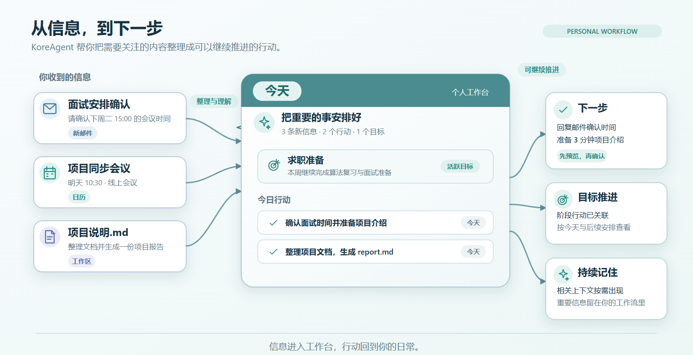
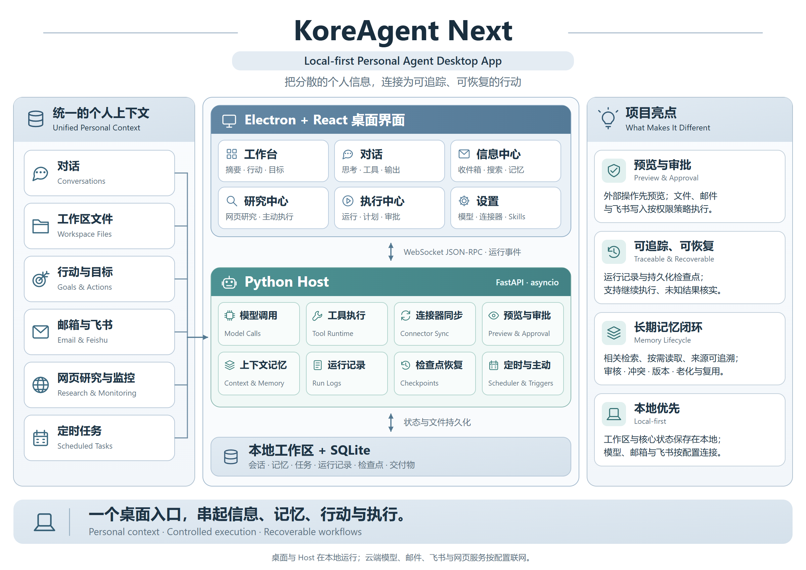

# KoreAgent

当前更新版本：**v0.2.0**。本版集中改进运行恢复、审批和跨模块状态一致性。[发布说明](docs/RELEASE_v0.2.0.md) · [更新历史](CHANGELOG.md)

> **记住重要的事，推进想做的事。**

**KoreAgent 是一个本地优先的个人 AI 工作台，连接你的信息、目标与日常任务。**

汇聚对话、文件、邮箱与飞书，通过长期记忆延续上下文，帮助你规划行动、执行任务；关键操作可审批，执行过程可追踪，中断后可恢复。

从一封邮件到一项行动，从一个目标到持续推进的计划，任务的来源、执行过程和结果都能在同一个桌面应用中找到。

[快速开始](#快速开始) · [核心功能](#核心功能) · [系统架构](#系统架构) · [测评与验证](#测评与验证) · [功能文档](docs/FEATURES.md) · [连接器配置](docs/CONNECTORS.md)



## 可以用它做什么

- **处理一封面试邮件**：在收件箱查看原文，与 Agent 讨论准备事项；在工作台选择接受行动建议，需要回复邮件或创建飞书日程时，再确认外部操作预览。
- **推进三个月的求职目标**：让 Agent 生成阶段行动、学习与复盘计划和定时提醒，继续讨论调整，确认后在目标详情中查看关联内容。
- **整理资料并交付报告**：读取工作区文档、结合网页研究生成报告，查看工具调用与产物；中断时保存检查点，之后恢复处理。

……

## 核心功能

- **让信息变成行动**<br/>
  统一接收邮件、飞书日历、任务和云文档。工作台筛选值得处理的信息，展示原文、分析依据与建议；用户可逐条接受、修改或忽略，将建议转为本地行动、目标关联或待审批的外部操作。

- **让长期目标持续推进**<br/>
  通过表单创建目标，或与 Agent 一起规划阶段行动、任务计划和自动化提醒。预览支持继续讨论与选择性接受，目标详情可以查看关联行动、任务和提醒；今日行动与后续行动按个人时区展示。

- **让任务执行可确认、可恢复**<br/>
  支持普通对话与计划模式。关键工具操作和外部写入经过权限控制，邮件与飞书写入提供预览和审批。运行记录展示工具调用、结果、Token 用量、错误和检查点，支持中断恢复、失败步骤续执行及未知结果核实。

- **让长期记忆有依据、可管理**<br/>
  根据当前问题检索相关记忆摘要，Agent 按需读取完整内容。记忆保留来源、置信度、审核状态、事实关系和版本，支持冲突处理、回滚、老化维护与使用记录查询。

- **让研究结果可以持续跟踪**<br/>
  结合网页和工作区文件形成带来源的研究报告，支持历史版本与 Markdown 导出。网页监控提供新增标题、链接、摘要和内容变化；统一搜索连接会话、记忆、外部信息与本地文件，并支持查看详情和打开来源。

此外，还支持兼容模型配置、可选运行预算、MCP 工具扩展，以及从成功任务中提炼可审核的 Skill 候选。完整页面和操作说明见 [功能文档](docs/FEATURES.md)。

## 设计亮点

### 外部信息先分析，再转为可选择的行动

邮箱、飞书日历、任务和文档同步后，原始内容仍保留在收件箱；工作台会为值得处理的内容生成结构化分析、重要性和具体建议。建议可以是创建本地行动、关联目标、执行外部操作或请求用户确认，用户可以逐条接受、修改或忽略。涉及邮件发送、日历、飞书任务和文档写入时，仍会进入独立的预览与审批流程。

### 外部写入保留可核实的执行状态

外部操作会保存预览、审批、参数、幂等操作 ID 和每个步骤的结果。系统区分成功、失败、部分成功和结果未知：失败步骤可以继续，结果未知时先查询远端或人工核实，再决定是否重试；已知远端对象的操作还可以使用补偿入口。这样网络超时不会被当成安全的失败，也不会直接盲目重复执行。

### 长期记忆按需进入上下文

每次对话先根据当前问题检索相关记忆，最多提供 **5 条**符合条件的摘要：候选遵守保存模式、置信度、隐私、有效状态和争议使用规则。Agent 需要细节时再调用 `memory_read` 读取全文，并在确实使用记忆时保留引用。

检索使用 SQLite FTS5 / BM25，并结合词语覆盖、时效、置信度和使用信号排序。系统分别记录摘要注入、全文读取和回答引用；事实置信度与老化分数独立维护，来源、冲突和版本也可以在记忆详情中追溯。

### 目标计划先讨论，再写入工作台

目标规划分为预览、讨论和应用三个阶段。Agent 可以先提出目标、阶段行动、任务计划和自动化提醒，用户可以继续修改或取消其中的部分；确认后才创建真实记录，并保留目标、行动、任务和提醒之间的关联。

### 研究结果保留来源和变化依据

网页研究报告保留来源、引用覆盖率和不确定性，支持历史版本与 Markdown 导出。网页监控保存快照、变化摘要、来源可信度和前后内容，用户可以查看详情、忽略更新、打开来源或与 Agent 讨论。

## 系统架构

桌面端负责交互与状态展示，Python Host 负责 Agent 执行、工具调度、连接器与后台任务，本地 SQLite 和工作区保存会话、记忆、检查点及交付物。



项目面向**单机、单用户、本地优先**的使用场景。使用云端模型或外部连接器时，相关内容会发送到所配置的服务；“本地优先”描述数据与应用的组织方式，不代表完全离线运行。

## 测评与验证

仓库提供四批项目综合测评集，检查最终回答、工具调用、审批、状态变化和恢复结果。

| 测评集 | 用例数 | 主要关注 |
| --- | ---: | --- |
| [基础集 v1](evals/personal_agent_eval_v1.json) | 52 | 对话、文件与研究、外部动作、恢复和 Skill 基线 |
| [扩展集 v2](evals/personal_agent_eval_v2.json) | 44 | 多轮约束、跨模块流程、安全、上下文与自动化 |
| [扩展集 v3](evals/personal_agent_eval_v3.json) | 106 | 复杂状态变化、真实连接器回读、前端控制与 MCP |
| [扩展集 v4](evals/personal_agent_eval_v4.json) | 120 | 工作台、外部信息建议、搜索详情、跨模块状态及 Runtime 边界 |

四批合计 **322 条用例**。当前数据采用校准后的版本，长期记忆专项数据与实验报告另行整理；产品长期记忆功能和综合集中的跨模块验证保留。

数据集关系、v4 的 12 类覆盖、人工协助要求、执行约定与评分方法见 [测评说明](evals/README.md)。本轮分阶段修复验收为316/322通过，6条未通过；最新恢复界面修复另有10项浏览器交互检查及64项后端隔离回归通过。[结果与限制](evals/RESULTS_v0.2.0.md)明确区分综合验收和定向回归，不将其称为最终版本统一重跑或单一模型解决率。此目录提供JSON数据及说明；不同版本比较需固定数据、模型、预算和环境。

## 快速开始

需要 Python 3.11+、Node.js 20+ 和 npm，以及一个兼容的模型 API。Windows 启动脚本优先使用 Python 3.12。当前提供源码运行方式。

### 1. 下载项目

```powershell
git clone https://github.com/haojunChen34/Kore-Agent.git
cd Kore-Agent
```

也可以从 GitHub 下载 ZIP 并解压，在解压后的项目目录打开终端。

### 2. 启动应用

在 Windows PowerShell 中运行：

```powershell
powershell -ExecutionPolicy Bypass -File .\scripts\start.ps1
```

脚本会创建虚拟环境、安装依赖、在缺少配置时从 `backend/.env.example` 创建 `backend/.env`，然后启动 Host 和 Electron。数据库及本地数据目录会自动初始化，无需下载其他人的数据库。

<details>
<summary>手动启动 Host 和桌面端</summary>

在项目根目录打开终端，启动 Host：

```powershell
cd backend
python -m venv .venv
.\.venv\Scripts\python.exe -m pip install -r requirements.txt
if (-not (Test-Path .env)) { Copy-Item .env.example .env }
.\.venv\Scripts\python.exe -m kore_next.server
```

另开终端，从项目根目录启动桌面端：

```powershell
cd desktop
npm ci
npm run electron:dev
```

</details>

### 3. 配置模型与可选连接器

- **模型**：在“设置”中配置默认模型、上下文窗口和运行预算。支持 OpenAI、DeepSeek、Qwen、Anthropic 及兼容 OpenAI API 的服务；也可通过 `backend/.env` 设置 `KORENEXT_PROVIDER`、`KORENEXT_MODEL`、`KORENEXT_BASE_URL` 和 `KORENEXT_API_KEY`。
- **邮箱（可选）**：在“信息中心 → 收件箱”配置 IMAP/SMTP 及应用专用授权码。
- **飞书（可选）**：在 `backend/.env` 填写自己的 App ID、App Secret 和回调地址，重启 Host 后点击“飞书 OAuth”。权限与授权步骤见 [连接器配置](docs/CONNECTORS.md)。

Host 默认监听 `http://127.0.0.1:8765`，健康检查为 `/health`，RPC 地址为 `ws://127.0.0.1:8765/rpc`。本地数据默认位于 `backend/.koreagent-next/`，工作区默认位于 `backend/workspace/`。

## 使用示例

**整理工作区并生成报告**

在对话中输入：

```text
整理工作区中的项目文档，先列文件，再总结，最后生成 report.md。
```

可以使用计划模式先确认步骤，再查看运行过程、审批和生成的交付物。

**共同规划一个长期目标**

在“工作台 → 新建目标”中选择让 Agent 帮助规划：

```text
我想在未来三个月准备求职，长期目标是完成算法面试准备。
请创建三个阶段性行动、一个学习和复盘任务计划，
并在每周日晚上八点提醒我复盘。
```

查看行动、任务步骤和提醒的具体内容，继续讨论调整，选择需要的部分后确认保存。外部写入动作仍走单独的预览和审批流程。

**基于一条外部信息讨论**

连接邮箱或飞书后，在收件箱打开一条信息，点击“与 Agent 讨论”：

```text
请根据这条信息列出我需要准备的事项，指出时间和地点中需要确认的部分。
先给出建议，暂时不要回复或修改日历。
```

实际发送讨论消息后，会话会同步到对话模块并保留来源，方便之后继续。

**持续关注一个网页**

在“研究中心 → 监控主题”填写主题、频率和来源 URL。没有 URL 时，Agent 会先提供候选网站供确认。监控运行后，可在工作台查看新增标题、链接、摘要和内容变化。

## 文档与项目结构

- [功能说明](docs/FEATURES.md)：页面、工作流和模块行为。
- [连接器说明](docs/CONNECTORS.md)：邮箱与飞书的配置、权限、同步和故障处理。
- [测评说明](evals/README.md)：四份测评集的覆盖范围、执行约定和评分方式。
- [贡献指南](CONTRIBUTING.md) · [安全说明](SECURITY.md)

```text
backend/       Python Host、Agent、工具、连接器与 SQLite 数据层
desktop/       Electron + React + TypeScript 桌面端
scripts/       Windows 启动脚本
docs/          功能和连接器说明
evals/         四个综合测评集与统一执行说明
```

## License

本项目采用 [MIT License](LICENSE)。
